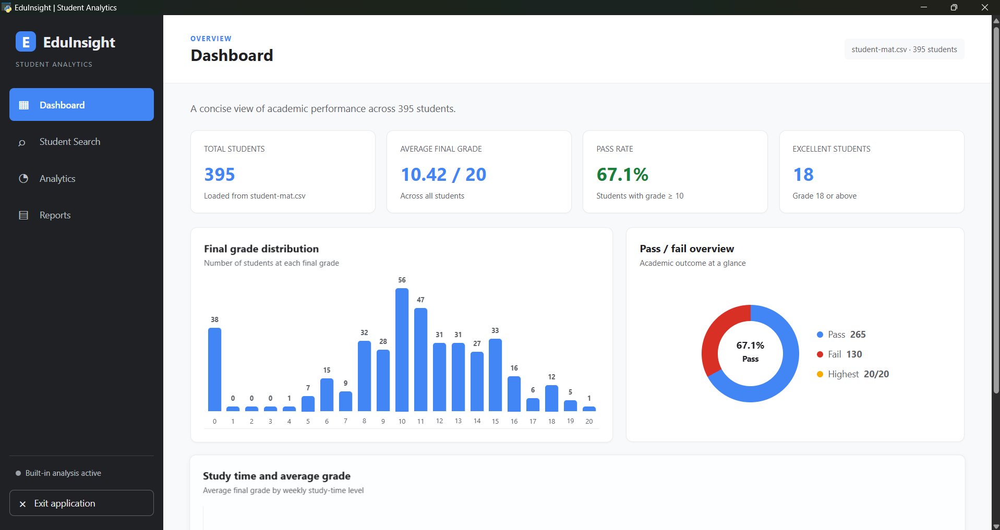
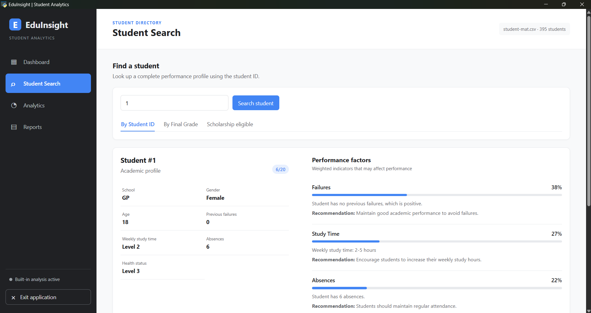
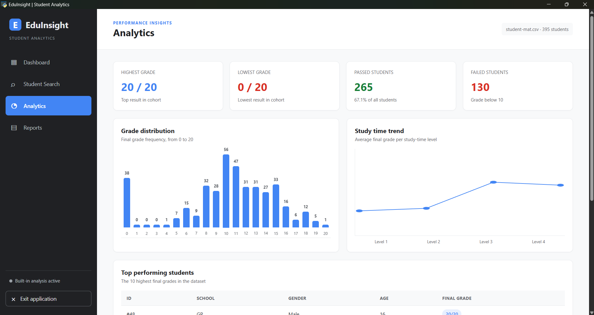
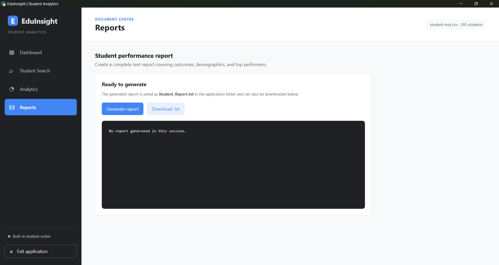

# EduInsight - Student Analytics System

## Overview

EduInsight is a Python-based student analytics system developed to analyze student academic performance using the UCI Student Performance Dataset.

The system provides both a console-based interface and a graphical user interface (GUI) built with PyWebView. It allows users to search student information, analyze academic results, visualize performance data, generate reports, and obtain AI-based performance comments.

## Features

- **Dashboard** - Display student statistics, grade distribution, and pass/fail overview.
- **Student Information Search** - Search student records by ID.
- **Academic Performance Analysis** - Calculate average, highest, and lowest grades, as well as pass and fail statistics.
- **Performance Factor Analysis** - Analyze factors such as previous failures, study time, absences, and health.
- **Grade Search** - Search students by final grade and view scholarship-eligible students.
- **Data Visualization** - Display student performance through charts.
- **Student Report Generation** - Generate and preview academic performance reports.
- **AI Performance Comments** - Generate comments using Ollama, with rule-based fallback analysis.

## Screenshots

### Dashboard


### Student Search


### Analytics


### Reports



## Technologies Used

- Python
- Pandas
- Matplotlib
- PyWebView
- Requests
- Ollama
- HTML
- CSS
- JavaScript

## Design System

| Token | Value |
| --- | --- |
| Primary | `#4285F4` |
| Sidebar | `#202124` |
| Background | `#F8F9FA` |
| Card | `#FFFFFF` |
| Hover | `#1A73E8` |

## Installation

Install the required libraries:

```bash
pip install -r requirements.txt
```

## Run the Application

**GUI Version:**

```bash
python gui.py
```

**Console Version:**

```bash
python main.py
```

Ollama is used for AI-based performance comments when the service is available. The system also provides rule-based fallback comments when Ollama is unavailable.

The GUI uses PyWebView to open the application in a native desktop window.

## Dataset

This project uses the Student Performance Dataset from the UCI Machine Learning Repository.

Dataset: https://archive.ics.uci.edu/dataset/320/student+performance

## Project Structure

```text
asss/
├── web/
│   ├── index.html
│   ├── styles.css
│   └── app.js
├── .gitignore
├── ai_comment.py
├── analyzer.py
├── gui.py
├── main.py
├── report.py
├── requirements.txt
├── student-mat.csv
├── student.py
├── visualization.py
├── GUI_EXPLANATION_CN.md
├── Student_Report.txt
└── README.md
```

## Project Background

This project was developed as a final assignment for TCKA213 Introduction to Python Programming at New Era University College.

The project demonstrates Python programming concepts, including functions, conditional statements, loops, exception handling, file handling, data structures, and Object-Oriented Programming (OOP).
